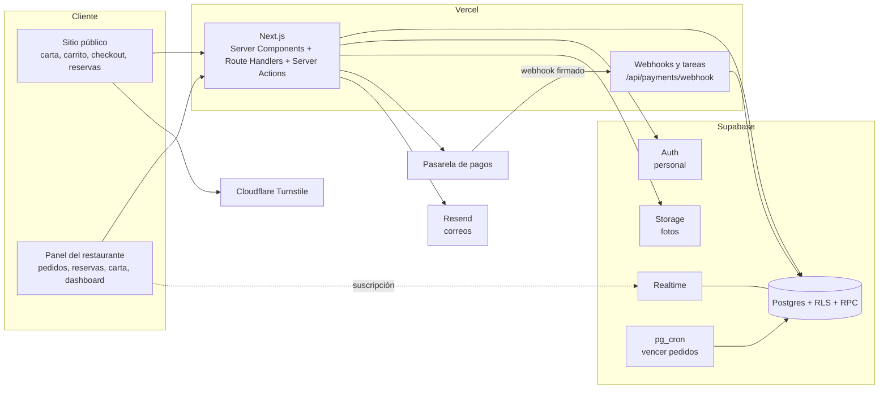

# 01 · Arquitectura y buenas prácticas

Parte de lo que **ya existe** (Next.js 15 App Router, Supabase con RLS, Vercel, Zod, Vitest y Playwright) y no cambia el stack: la versión 2 se monta sobre el monolito actual.

## 1. Principio rector

> Un solo despliegue (Next.js) + una sola base (Supabase). Los módulos nuevos viven en `src/features/<módulo>` y se comunican por **tipos y funciones**, no por servicios separados. Con un local o dos y un equipo de dos personas, separar en microservicios solo agregaría costo y puntos de falla.

## 2. Vista general



## 3. Capas dentro de cada módulo

Mismo patrón para todos los módulos nuevos; los existentes (`orders`, `reservations`, `catalog`) ya lo siguen en buena parte.

```
src/features/<módulo>/
  schema.ts      Zod: entradas y salidas (único contrato entre front y back)
  queries.ts     Lectura (server-only). Sin lógica de pantalla.
  actions.ts     Escritura (Server Actions o route handlers): valida, autoriza, llama a la base
  components/    Pantallas y piezas de UI (client solo si hace falta)
  *.test.ts      Unitarias del módulo
```

Reglas:

1. **La UI nunca habla con la base directamente para escribir.** Escribe por `actions.ts`, que valida con Zod y comprueba el rol.
2. **Toda regla de negocio crítica vive en Postgres** (función RPC o restricción), no solo en TypeScript: aforo y cupo de terraza, descuento de stock, estado del pago. TypeScript valida para dar buenos mensajes; la base garantiza que no se rompa.
3. **Los montos van en centavos enteros** (`price_cents`) y en soles (PEN). Nunca decimales flotantes.
4. **Las fechas se guardan en UTC (`timestamptz`) y se muestran en `America/Lima`.** Los reportes agrupan «por día» con `at time zone 'America/Lima'`; si no, las ventas de la noche caen en el día siguiente.

## 4. Seguridad en tres capas (defensa en profundidad)

| Capa | Dónde                                         | Qué hace                                                                         |
| ---- | --------------------------------------------- | -------------------------------------------------------------------------------- |
| 1    | Ruta del panel (layout/guard)                 | Sin sesión → `/panel/ingresar`. Rol sin permiso → página «sin acceso».           |
| 2    | `requireStaff(roles)` en cada acción/consulta | Lee `staff_roles` en el servidor; nunca confía en el rol que mande el navegador. |
| 3    | RLS en Postgres                               | Aunque la capa 1 y 2 fallen, la base rechaza lo que el rol no puede hacer.       |

Ya existe `getStaffSession()` en `src/features/orders/panel.ts`; se generaliza a `requireStaff()` y se mueve a `src/features/staff/`.

Otras reglas:

- **La clave secreta de Supabase (`SUPABASE_SECRET_KEY`) solo en el servidor**, y solo para lo que RLS no deba permitir (invitar personal, webhooks de pago). Nunca en variables `NEXT_PUBLIC_*`.
- **Datos de tarjeta jamás pasan por nuestro servidor.** La pasarela tokeniza en el navegador y nosotros recibimos un token; así el alcance PCI es el mínimo.
- **Webhooks:** verificar firma, rechazar fechas viejas e ignorar duplicados (idempotencia por `provider_event_id`, ya único en `payment_events`).
- **Límite de peticiones** (`rate_limits`, ya existe) en login, checkout, pago y reservas; Turnstile en formularios públicos.
- **Auditoría:** tabla `audit_log` con quién cambió qué (precios, stock, roles, reembolsos), con valor anterior y nuevo. Solo lectura para `admin`.

## 5. Datos nuevos (resumen)

Detalle de columnas en [02-modulos.md](02-modulos.md). Todas las tablas nuevas llevan RLS activado desde su migración.

| Tabla / cambio                                                                         | Para qué                                                            |
| -------------------------------------------------------------------------------------- | ------------------------------------------------------------------- |
| `staff_role` + valor `salon`                                                           | Rol para atender reservas sin ver ventas.                           |
| `staff_roles.display_name`, `is_active`                                                | Nombre visible y desactivar a alguien sin borrar su historial.      |
| `branch_products (branch_id, product_id, is_available, stock_qty, stock_resets_daily)` | Disponibilidad y stock **por sede** (hoy `is_available` es global). |
| `audit_log`                                                                            | Quién cambió qué y cuándo.                                          |
| `branches.terrace_max_parties_per_slot`                                                | Límite de reservas de terraza por franja (nulo = sin límite).       |
| `reservations.source`, `created_by`, `notes`                                           | Origen (web, teléfono, WhatsApp), quién la registró y observación.  |
| `reservations.acknowledged_at / acknowledged_by`                                       | «Ya la vi»: apaga la alerta para todo el equipo.                    |
| `payment_events` (ya existe) + `orders.payment_*`                                      | Estado del pago y eventos de la pasarela.                           |
| Funciones `dashboard_*`                                                                | Agregados para el dashboard, en SQL, con `security_invoker`.        |

## 6. Entornos y despliegue

| Entorno                     | Para qué                                                         | Notas                                                                                        |
| --------------------------- | ---------------------------------------------------------------- | -------------------------------------------------------------------------------------------- |
| Local                       | Desarrollo con Supabase local (`supabase start`) o con mocks MSW | Cada quien con su `.env.local`. Nunca se sube.                                               |
| `berypez-dev`               | Previews de PR                                                   | Base de pruebas con datos ficticios.                                                         |
| `berypez-demo` → producción | Lo que ve la dueña                                               | Hoy es la demo; cuando la dueña apruebe pasa a ser el proyecto de producción con su dominio. |

Flujo de ramas (ya vigente): `feat/*` → PR a `develop` → PR de release `develop` → `main`. La publicación a Vercel va por GitHub Actions (`publicar.yml`).

Migraciones:

- Una migración por cambio lógico, en `supabase/migrations/AAAAMMDDHHMMSS_nombre.sql`, **solo hacia adelante** (no se editan las ya aplicadas).
- Agregar un valor a un `enum` (por ejemplo `salon` en `staff_role`) va en **su propia migración**: Postgres no deja usar el valor nuevo en la misma transacción que lo crea.
- Después de cada migración: `supabase gen types` → `src/types/database.ts` en el mismo PR.
- Antes de producción, probar la migración sobre una copia de los datos reales (no solo sobre la base vacía).

## 7. Pruebas (pirámide)

| Nivel          | Herramienta                                                | Qué cubre en la v2                                                                                                  |
| -------------- | ---------------------------------------------------------- | ------------------------------------------------------------------------------------------------------------------- |
| Unitarias      | Vitest                                                     | Esquemas Zod, cálculo de disponibilidad, cupo por franja y bloqueo de terraza, estados de pago.                     |
| Base de datos  | SQL de prueba (pgTAP o script en CI) contra Supabase local | Políticas RLS por rol, cupo de terraza, descuento de stock concurrente.                                             |
| Integración    | Vitest + MSW                                               | Webhook de pago (firma buena, firma mala, duplicado, fuera de orden).                                               |
| E2E            | Playwright                                                 | Login por rol, editar precio, reservar por teléfono desde el panel y ver la franja tachada en la web, pago sandbox. |
| No funcionales | Lighthouse CI, axe                                         | El panel también se puede usar con teclado; el sitio público no empeora su rendimiento.                             |

**Las pruebas de RLS son obligatorias** para cada tabla nueva: para cada rol, un caso que debe poder y uno que no.

## 8. Observabilidad y operación

- **Errores:** registrar en servidor con contexto (módulo, rol, id de pedido) sin datos personales. Si el equipo lo aprueba, sumar Sentry (tiene plan gratuito; verificar límites antes).
- **Pagos:** todo evento de la pasarela se guarda en `payment_events`, aunque falle la verificación; es la bitácora para resolver reclamos.
- **Respaldo:** el plan Pro de Supabase incluye copias diarias con retención corta (ver [05-presupuesto.md](05-presupuesto.md)); además, un `pg_dump` semanal guardado fuera si la dueña lo pide.
- **Tareas programadas:** vencer pedidos con pago pendiente con `pg_cron` en Supabase (cada pocos minutos). Es preferible a un cron de Vercel porque el plan gratuito de Vercel limita la frecuencia y, además, la lógica queda junto a los datos.

## 9. Convenciones de código

- TypeScript estricto, sin `any`. Zod en toda frontera (entrada de formularios, webhooks, respuestas de la pasarela).
- Nombres de tablas y columnas en inglés (como hoy); textos de interfaz y mensajes de error en español.
- Componentes del panel accesibles (foco, ARIA, contraste); el panel se usa en un celular o tablet en cocina, así que **objetivos táctiles ≥ 44 px**.
- Movimiento solo si respeta `prefers-reduced-motion` (ya hay sistema en `src/styles/motion.css`). El panel no lleva el fondo de mariscos.
- Commits con prefijos `feat`, `fix`, `docs`, `test`, `chore`; PR pequeños (una idea por PR) con descripción de qué cambia y cómo probarlo.

## 10. Definición de «terminado» para cualquier tarea de la v2

- [ ] Funciona con el rol correcto y se bloquea con los otros (probado, no supuesto).
- [ ] Migración + tipos regenerados + RLS + prueba de RLS.
- [ ] Esquema Zod y mensajes de error en español.
- [ ] Pruebas unitarias del módulo y, si toca un flujo importante, un E2E.
- [ ] CI en verde (lint, tipos, formato, pruebas, build).
- [ ] Revisado por la otra persona.
- [ ] Documentado en `docs/` si cambia una regla o una variable de entorno (`.env.example` al día).
- [ ] Probado en celular (el panel se usa en tablet/celular).
