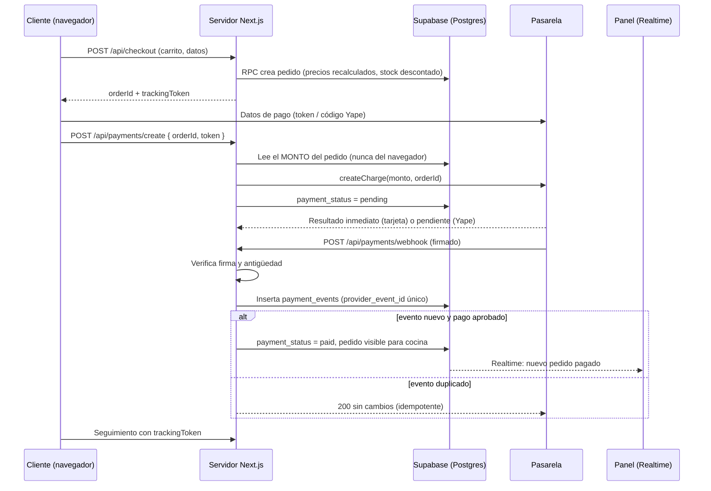

# 06 · Cómo integrar la pasarela de pagos (requisitos)

Complementa el [ADR 0001](../decisiones/0001-pasarela-de-pagos.md), que ya decidió: **sandbox con Mercado Pago**, **Plin con adaptador `mock`** en la demo y **producción con Izipay o Culqi** según cotización. Aquí se detalla lo que falta: qué necesita el negocio, qué necesita el código, el flujo, las pruebas y la lista de salida a producción.

> Lo marcado con **(fuente)** viene de las consultas del 21-nov-2026 (enlaces al final). Lo marcado con **(a confirmar)** es práctica habitual o supuesto razonable que **cada proveedor debe confirmar por escrito**: los requisitos exactos los fija quien contrata.

## 1. Quién hace qué en el trámite

| Parte                     | Responsabilidad                                                                                                                                             |
| ------------------------- | ----------------------------------------------------------------------------------------------------------------------------------------------------------- |
| **El negocio (la dueña)** | Es quien se afilia: firma el contrato con el proveedor, a su nombre y con su RUC y su cuenta donde recibe los abonos. Nosotros no podemos hacerlo por ella. |
| **Nosotros**              | Preparamos el sitio para pasar la revisión, integramos con las credenciales que el proveedor entregue y probamos.                                           |

## 2. Requisitos del negocio (checklist para la dueña)

| #   | Requisito                                                                                               | Nota                                                                                                                                                                    |
| --- | ------------------------------------------------------------------------------------------------------- | ----------------------------------------------------------------------------------------------------------------------------------------------------------------------- |
| 1   | **RUC vigente** del negocio                                                                             | **(fuente)** El contrato marco de adquirencia de un banco exige RUC vigente. Una fuente indica que para Izipay Online basta DNI o RUC; confirmar cuál aplica a su caso. |
| 2   | Cuenta bancaria a nombre del negocio (o del titular del RUC) para recibir los abonos                    | **(a confirmar)**                                                                                                                                                       |
| 3   | Documento de identidad del representante y, si es persona jurídica, vigencia de poder / ficha registral | **(a confirmar)**                                                                                                                                                       |
| 4   | Cuentas ya existentes: Yape Empresas, POS, cuenta con Izipay, Niubiz o Culqi                            | Pregunta pendiente del ADR; puede acortar el trámite o cambiar el proveedor elegido.                                                                                    |
| 5   | Aceptar el contrato, la tarifa y el plazo de abono                                                      | Firma y aprobación de ella.                                                                                                                                             |
| 6   | Definir cómo emite sus comprobantes (boleta/factura electrónica)                                        | Lo ve con su contador; no lo resuelve la pasarela. Ver [05-presupuesto.md](05-presupuesto.md) §5.                                                                       |

**Plazo:** una guía local menciona de **5 a 15 días hábiles** para la afiliación, durante los cuales el proveedor revisa el sitio y la documentación y asigna el código de comercio **(fuente, de un blog; confirmar con el proveedor)**. Por eso se arranca en la reunión 1.

**Costo de afiliación:** las fuentes se contradicen (una dice hasta S/ 200 de instalación según el plan; otra dice sin costo). Se pregunta en la cotización.

## 3. Requisitos del sitio (lo que revisan antes de aprobar)

Una de las fuentes indica que el proveedor **evalúa el sitio web** antes de asignar el código. Dejarlo listo antes de la solicitud:

- [ ] Precios en soles (PEN), con impuestos claros; el total del pedido visible antes de pagar.
- [ ] Política de **cambios, cancelaciones y devoluciones** (qué pasa si el pedido no llega o si se cancela una reserva con pago).
- [ ] **Términos y condiciones** y **política de privacidad** (ya hay base legal en el sitio; revisar que mencione el pago en línea).
- [ ] Datos de contacto reales (dirección, teléfono, correo) y razón social con RUC.
- [ ] **Libro de Reclamaciones** (ya existe) y enlace en el pie de página.
- [ ] **Medios de pago anunciados = medios de pago que funcionan.** Hoy el sitio promete Yape, Plin y tarjeta aunque solo funciona efectivo (issue #59): se corrige antes de solicitar la afiliación.
- [ ] HTTPS en el dominio definitivo (Vercel lo da por defecto).

## 4. Requisitos técnicos

| Tema                    | Qué hace falta                                                                                                                                                                                           |
| ----------------------- | -------------------------------------------------------------------------------------------------------------------------------------------------------------------------------------------------------- |
| Credenciales de prueba  | Mercado Pago: cuenta de desarrollador y credenciales de prueba (acción pendiente de Axel, según el ADR).                                                                                                 |
| Credenciales reales     | Las entrega el proveedor tras la afiliación. Van **solo** en variables de entorno de Vercel del proyecto de producción; nunca en el repositorio ni en el chat.                                           |
| Variables de entorno    | `PAYMENTS_PROVIDER`, y por proveedor: `MP_ACCESS_TOKEN`, `MP_WEBHOOK_SECRET`, `NEXT_PUBLIC_MP_PUBLIC_KEY` (los nombres definitivos de Izipay/Culqi se fijan al elegir). Se documentan en `.env.example`. |
| URL pública del webhook | `https://<dominio>/api/payments/webhook`, accesible desde internet; se registra en el panel del proveedor (una por entorno).                                                                             |
| Dominios autorizados    | El proveedor suele pedir los dominios desde donde se carga su formulario de pago **(a confirmar)**.                                                                                                      |
| Tokenización            | Los datos de tarjeta se capturan con el formulario o los campos seguros del proveedor; a nuestro servidor llega solo un **token**. Así el alcance PCI es mínimo.                                         |
| Tareas programadas      | `pg_cron` para vencer pedidos con pago pendiente y para la conciliación diaria.                                                                                                                          |
| Panel                   | Botón de **reembolso** (solo `admin`) y vista del historial de pagos de cada pedido.                                                                                                                     |

## 5. Arquitectura del módulo

```
src/features/payments/
  provider.ts            interfaz PaymentProvider { createCharge, parseWebhook, refund, getStatus }
  providers/
    mercadopago.ts       sandbox real (Yape, tarjeta)
    mock.ts              Plin en la demo y pruebas automáticas
    izipay.ts | culqi.ts producción (un archivo que cumple la misma interfaz)
  schema.ts              Zod: entrada del cobro, eventos normalizados
  service.ts             orquesta: lee el pedido, cobra, actualiza estados
  webhook.ts             verifica, deduplica, aplica
```

Cambiar de proveedor = agregar un archivo y cambiar `PAYMENTS_PROVIDER`; el resto del sistema no se entera.

## 6. Flujo de un pago



### Reglas del flujo

1. **El monto sale siempre de la base**, calculado por el servidor al crear el pedido. Si el navegador manda otro monto, se ignora.
2. **Pedidos con pago en línea no llegan a cocina hasta estar `paid`.** Los pedidos en efectivo siguen su camino actual. (Se valida con la lógica de estados del tablero antes de implementarlo.)
3. **El webhook manda, no la pantalla.** Aunque el cliente cierre la pestaña después de pagar, el pedido se confirma por el webhook.
4. **Idempotencia:** el mismo evento recibido dos veces no cambia nada (`provider_event_id` único en `payment_events`). Se guarda todo evento, también los rechazados por firma, para auditoría.
5. **Eventos fuera de orden:** un `pending` que llega después de un `paid` no baja el estado. La máquina de estados solo avanza en las transiciones permitidas.
6. **Vencimiento:** un pedido con pago `pending` más de N minutos (a definir, p. ej. 15) se cancela y devuelve el stock. Antes de cancelar se consulta el estado a la pasarela (`getStatus`) por si el webhook se perdió.
7. **Reembolsos:** solo `admin`, desde el panel; registra quién y por qué en `audit_log`; el pedido pasa a `refunded`.
8. **Topes de Yape:** el límite por código lo define el proveedor (S/ 2,000 en Izipay y Culqi según el ADR); si un pedido lo supera, se ofrece otro medio.

### Máquina de estados del pago (`payment_status`, ya existe en la base)

```
unpaid ──► pending ──► paid ──► refunded
              └──────► failed ──► (reintento: vuelve a pending)
```

## 7. Seguridad (revisión obligatoria antes de producción)

- [ ] Firma del webhook verificada con el secreto del entorno correcto; rechazo (401) si no coincide.
- [ ] Verificar la **antigüedad** del evento (evita repeticiones antiguas).
- [ ] Ninguna clave en el repositorio, en el cliente ni en los logs; solo en variables de entorno del servidor.
- [ ] El endpoint de creación de cobro tiene límite de peticiones y Turnstile.
- [ ] No se registra en logs ningún dato de tarjeta ni el cuerpo completo de la petición de pago.
- [ ] Pruebas de manipulación: monto cambiado, pedido de otra persona, pedido ya pagado.
- [ ] Respuesta rápida del webhook (200 en pocos segundos); el trabajo pesado va después.

## 8. Plan de pruebas de la pasarela

Casos mínimos en sandbox (Mercado Pago ofrece números de Yape de prueba de aprobado y de varios rechazos, ver ADR):

| Caso                                 | Resultado esperado                                                   |
| ------------------------------------ | -------------------------------------------------------------------- |
| Pago aprobado (Yape y tarjeta)       | Pedido `paid`, aparece en cocina, correo de confirmación.            |
| Pago rechazado (varios motivos)      | Pedido no llega a cocina, mensaje claro, se puede reintentar.        |
| Pago pendiente que luego se aprueba  | Pasa a `paid` solo al llegar el webhook.                             |
| Pago pendiente que expira            | Pedido cancelado y stock devuelto.                                   |
| Mismo webhook dos veces              | Un solo cambio; segunda respuesta sin efecto.                        |
| Webhook con firma inválida o vieja   | Rechazado y registrado, sin cambios en el pedido.                    |
| Webhooks fuera de orden              | El estado final es el correcto.                                      |
| Cliente cierra la pestaña tras pagar | El pedido igual se confirma.                                         |
| Monto alterado desde el navegador    | Se ignora; se cobra el monto de la base.                             |
| Reembolso total                      | Pedido `refunded` y registro en `audit_log`.                         |
| Pasarela caída o lenta               | Mensaje claro, el pedido no queda «pagado» por error, hay reintento. |
| Plin (adaptador `mock`)              | Marcado como simulado en la demo; no se ofrece así en producción.    |

Pruebas automáticas (Vitest + MSW) para las reglas; Playwright para el recorrido del cliente con el adaptador `mock`; pruebas manuales en sandbox del proveedor real.

## 9. Lista de salida a producción

- [ ] Afiliación aprobada, credenciales reales recibidas y guardadas solo en Vercel (producción).
- [ ] Webhook de producción registrado y probado con un pago real de monto mínimo (y su reembolso).
- [ ] Tarifa, plazo de abono y manejo de contracargos **por escrito**.
- [ ] Texto del sitio coincide con los medios de pago activos (#59).
- [ ] Conciliación: el primer abono del banco coincide con los pedidos pagados del dashboard.
- [ ] Alguien del equipo del local sabe hacer un reembolso y dónde ver los pagos.
- [ ] Plan de reversa: interruptor para ofrecer solo efectivo si el proveedor tiene una caída (`PAYMENTS_PROVIDER=off` o bandera por sede).

## 10. Preguntas para pedir la cotización a cada proveedor

1. Comisión por tarjeta nacional, extranjera y por Yape/Plin; si hay monto fijo por operación; si el IGV va aparte.
2. Plazo de abono y costo por abono inmediato.
3. Costo de afiliación, instalación y mensualidad, si existen.
4. Topes de Yape y Plin por operación.
5. Manejo de contracargos y plazos.
6. Entorno de pruebas: ¿lo entregan antes de aprobar la afiliación? ¿Tiempo real de aprobación?
7. Webhooks: eventos disponibles, método de firma y reintentos.
8. Soporte técnico: canal y horario.
9. Reembolsos por API: ¿totales y parciales?
10. Documentos exactos que pide para su caso (persona natural con negocio o jurídica).

## 11. Fuentes (21-nov-2026)

- [Izipay · medios de pago web (doc. oficial)](https://developers.izipay.pe/web-core/) y [Izipay vs Niubiz vs Culqi (KOM)](https://kom.pe/izipay-vs-niubiz-vs-culqi/): revisión del sitio, 5 a 15 días hábiles, costo de instalación variable.
- [Izipay Online (Global66)](https://www.global66.com/blog/?p=16245): afiliación con DNI o RUC y sin costo, según esa fuente.
- [Contrato marco de adquirencia (BBVA)](https://www.bbva.pe/content/dam/public-web/peru/documents/empresas/cobros-y-pagos/soluciones-de-pago/E0173_ADQUIRENCIA_Contrato_marco_de_Adquirencia.pdf): RUC vigente y tarifa determinada por afiliado.
- [Yape en Checkout API (Mercado Pago)](https://www.mercadopago.com.pe/developers/es/docs/checkout-api-payments/integration-configuration/yape): sandbox y pruebas.
- [Manual Shopify de Culqi (webhook `order.status.changed`)](https://docs.culqi.com/pdf/manual_shopify.pdf).
